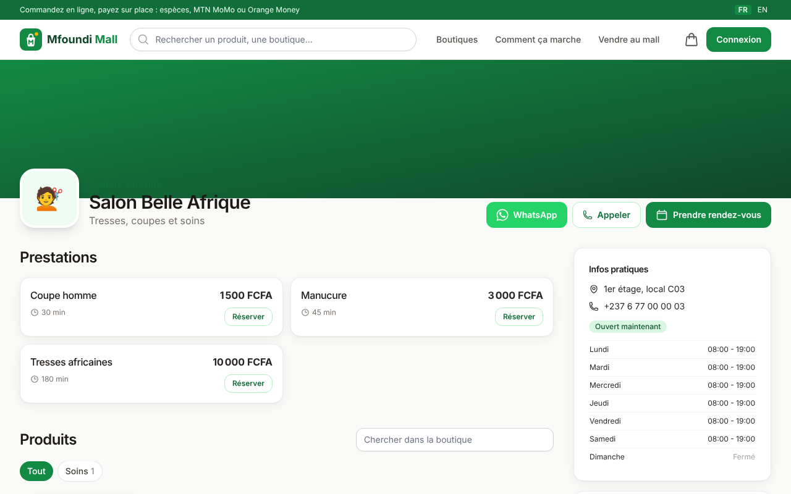
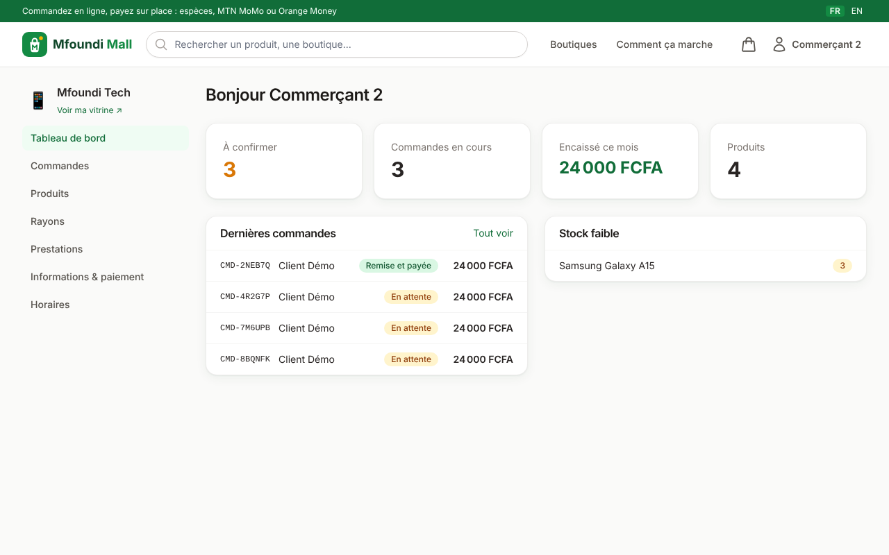
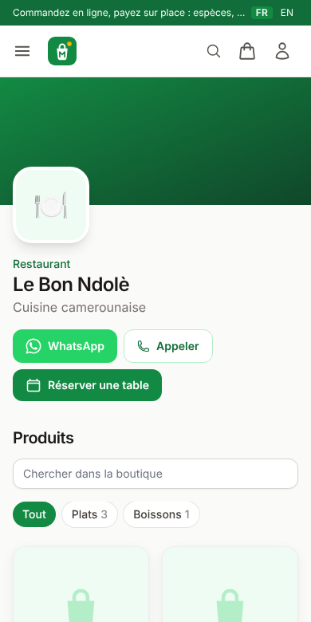

# Mfoundi Mall en ligne

Plateforme web des boutiques du **Mfoundi Mall** (Yaoundé, Cameroun). Chaque boutique du mall (épicerie, technologie, coiffure, restaurant, bar, parfumerie, électroménager, cave...) crée son espace, publie produits et services et reçoit commandes et réservations.

Pensée pour le contexte local :

- prix en **Franc CFA (FCFA)** ;
- **paiement sur place** uniquement : espèces, MTN Mobile Money ou Orange Money, devant le commerçant ou le livreur ;
- **retrait en boutique** avec code à 6 chiffres, ou **livraison** payée à la réception ;
- contact et commande via **WhatsApp** ;
- **réservations** de rendez-vous (salons) et de tables (restaurants, bars) ;
- connexion par **numéro de téléphone** (+237) ou e-mail ;
- interface **mobile d'abord**, en **français** et **anglais**.


## Fonctionnalités

| Client | Commerçant | Administration du mall |
| --- | --- | --- |
| Recherche instantanée, filtres par type et niveau | Création de boutique (type, niveau, local) | Validation et suspension des boutiques |
| Panier multi-boutiques | Catalogue : rayons, produits, photos, stock, promotions | Mise en avant sur l'accueil |
| Commande par boutique, retrait ou livraison | Prestations (coupe, réparation, menu...) | Gestion des types de boutique |
| Code de retrait, suivi des statuts | Traitement des commandes, vérification du code | Vue globale commandes et réservations |
| Réservation de rendez-vous et de tables | Confirmation des réservations | Gestion des utilisateurs |
| Commande pré-remplie sur WhatsApp | Horaires, moyens de paiement, livraison | |
| Historique commandes et réservations | Tableau de bord : à confirmer, encaissé du mois, stock faible | |

## Stack

Django 5.2, HTMX 2, Tailwind CSS 3, PostgreSQL 16, Gunicorn, Nginx, Docker Compose. Tests avec pytest, lint avec ruff, intégration continue GitHub Actions.

## Démarrage rapide

```bash
python3 -m venv .venv && source .venv/bin/activate
```

```bash
make install && make css
```

```bash
python manage.py compilemessages --ignore=node_modules
python manage.py migrate
python manage.py seed_demo
make run
```

Ouvrir http://127.0.0.1:8000. Comptes de démonstration : client `670000000`, commerçants `650000001` à `650000006`, mot de passe `demo12345`.

Avec Docker :

```bash
docker compose up --build
```

## Documentation

- **Développeurs** : [installation](docs/developpeur/installation.md), [développement](docs/developpeur/developpement.md), [architecture](docs/developpeur/architecture.md), [configuration](docs/developpeur/configuration.md), [déploiement](docs/developpeur/deploiement.md)
- **Utilisateurs** : [clients](docs/utilisateur/client.md), [commerçants](docs/utilisateur/commercant.md), [administration du mall](docs/utilisateur/administrateur.md)

## Captures

| Boutique | Espace commerçant | Mobile |
| --- | --- | --- |
|  |  |  |

## Tests

```bash
make test
make lint
```
