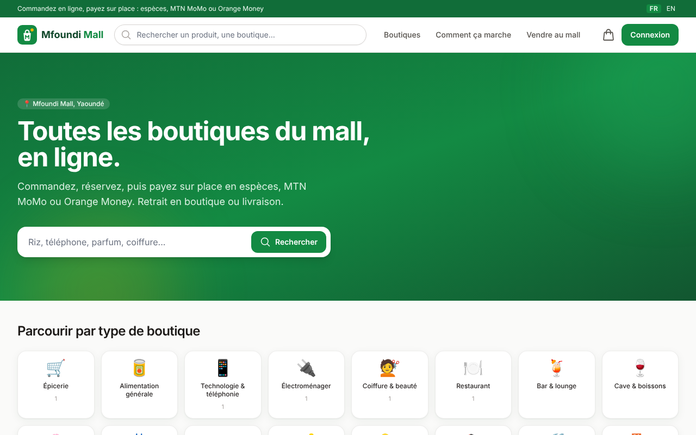
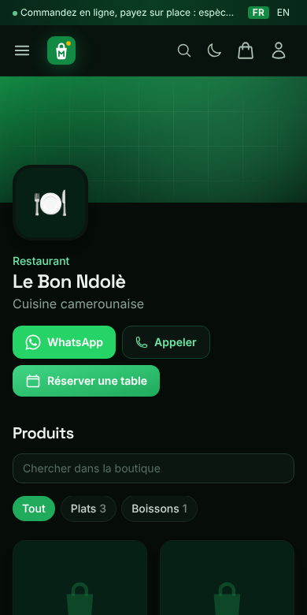
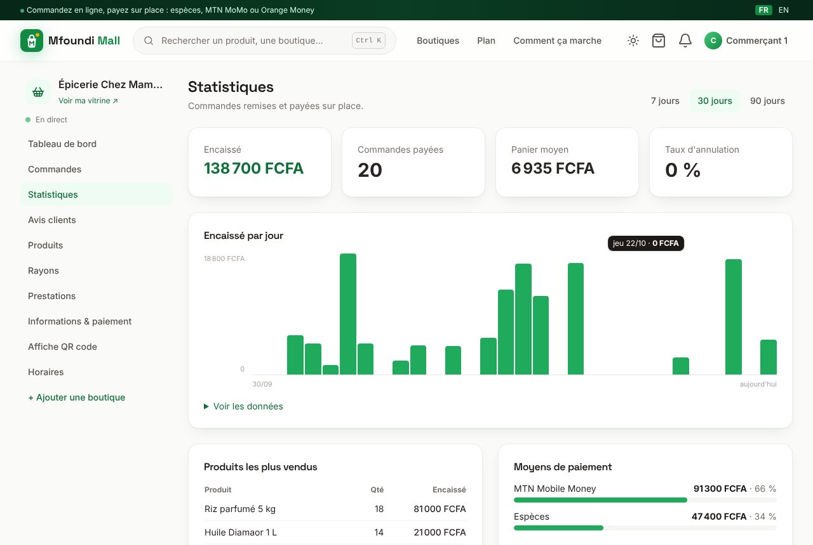
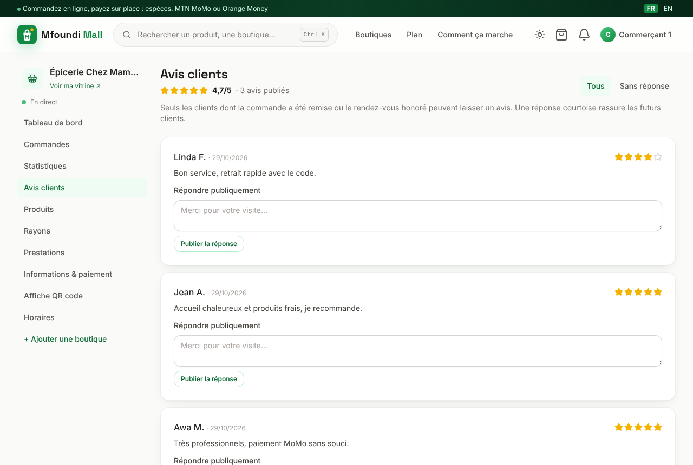
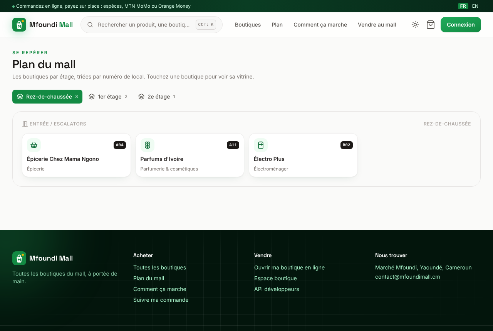

<p align="center">
  
</p>

<h1 align="center">Mfoundi Mall en ligne</h1>

<p align="center">
  <a href="https://github.com/Aziguy/fleaMarketOnline/actions/workflows/ci.yml"></a>
  <a href="https://github.com/Aziguy/fleaMarketOnline/actions/workflows/docs.yml"></a>
  <a href="https://aziguy.github.io/fleaMarketOnline/"></a>
  <a href="https://aziguy.github.io/fleaMarketOnline/"></a>
  <br>
  
  
  
  
  
  
  
  
  <a href="https://github.com/astral-sh/ruff"></a>
  <a href="LICENSE"></a>
  <a href="CONTRIBUTING.md"></a>
</p>

<p align="center">
  <a href="https://aziguy.github.io/fleaMarketOnline/"><strong>Documentation</strong></a> ·
  <a href="https://aziguy.github.io/fleaMarketOnline/demo/">Essayer en local</a> ·
  <a href="CONTRIBUTING.md">Contribuer</a> ·
  <a href="https://github.com/Aziguy/fleaMarketOnline/issues">Issues</a>
</p>

Plateforme web des boutiques du **Mfoundi Mall** (Yaoundé, Cameroun). Chaque boutique du mall (épicerie, technologie, coiffure, restaurant, bar, parfumerie, électroménager, cave...) crée son espace, publie produits et services et reçoit commandes et réservations.

Pensée pour le contexte local :

- prix en **Franc CFA (FCFA)** ;
- **paiement sur place** uniquement : espèces, MTN Mobile Money ou Orange Money, devant le commerçant ou le livreur ;
- **retrait en boutique** avec code à 6 chiffres, ou **livraison** payée à la réception ;
- contact et commande via **WhatsApp** ;
- **réservations** de rendez-vous (salons) et de tables (restaurants, bars) ;
- connexion par **numéro de téléphone** (+237) ou e-mail ;
- interface **mobile d'abord**, en **français** et **anglais**, thème **clair, sombre ou système** ;
- **application installable** (PWA), consultable hors ligne ;
- commerçants prévenus **en direct** des nouvelles commandes ;
- **avis clients vérifiés**, **favoris** avec alerte de retour en stock, **statistiques** et export comptable ;
- **plan du mall** par étage et **affiche QR code** pour chaque vitrine ;
- **double authentification** au choix (application, clés d'accès, e-mail, codes de secours) et alertes de connexion ;
- **assistant IA** (Claude) et **API REST** documentée.



## Fonctionnalités

| Client | Commerçant | Administration du mall |
| --- | --- | --- |
| Recherche instantanée, filtres par type et niveau | Création de boutique (type, niveau, local) | Validation et suspension des boutiques |
| Panier multi-boutiques | Catalogue : rayons, produits, photos, stock, promotions | Mise en avant sur l'accueil |
| Commande par boutique, retrait ou livraison | Prestations (coupe, réparation, menu...) | Gestion des types de boutique |
| Code de retrait, suivi des statuts | Traitement des commandes, vérification du code | Vue globale commandes et réservations |
| Réservation de rendez-vous et de tables | Confirmation des réservations | Gestion des utilisateurs |
| Commande pré-remplie sur WhatsApp | Horaires, moyens de paiement, livraison | |
| Historique commandes et réservations | Tableau de bord : à confirmer, encaissé du mois, stock faible | Supervision : `/healthz`, logs JSON |
| Palette de recherche (Ctrl+K), recherche élargie par l'IA | Commandes et réservations en direct (son, notification) | Jetons d'API |
| Application installable, mode hors ligne, thème sombre | Descriptions produits rédigées par l'IA | Modération des avis |
| Favoris et alerte de retour en stock, notifications | Logo et bannière avec aperçu, images optimisées en WebP | |
| Avis vérifiés (clients servis uniquement) | Réponses aux avis, statistiques de ventes, export CSV | |
| Plan du mall par étage | Affiche QR code à imprimer pour la vitrine | |
| Double authentification, clés d'accès, appareils connectés | Idem, recommandée sur le tableau de bord | Double authentification obligatoire, réinitialisation |

## Stack

| Couche | Technologies |
| --- | --- |
| Serveur | Django 5.2 en ASGI (Gunicorn + Uvicorn), Server-Sent Events, Django Ninja (API REST, OpenAPI) |
| Interface | HTMX 2, Tailwind CSS 3 (tokens de thème), icônes Lucide, View Transitions, service worker (PWA) |
| Données | PostgreSQL 16, Redis (cache) |
| IA | API Claude (sorties structurées, repli serveur) |
| Sécurité | Double authentification TOTP (pyotp), clés d'accès WebAuthn, secrets chiffrés (Fernet), limitation des essais |
| Qualité | pytest (couverture), ruff, mypy strict, GitHub Actions, Dependabot |
| Exploitation | Docker Compose, Nginx, `/healthz`, logs JSON avec identifiant de requête |

## Démarrage rapide

```bash
python3 -m venv .venv && source .venv/bin/activate
```

```bash
make install && make css
```

```bash
python manage.py compilemessages --ignore=node_modules
python manage.py migrate
python manage.py seed_demo
make run
```

Ouvrir http://localhost:8000. Comptes de démonstration : client `670000000`, commerçants `650000001` à `650000006`, mot de passe `demo12345`.

Avec Docker :

```bash
docker compose up --build
```

## Documentation

La documentation complète est publiée sur **[aziguy.github.io/fleaMarketOnline](https://aziguy.github.io/fleaMarketOnline/)** (sources dans `docs/`).

- **Utilisateurs** : [clients](https://aziguy.github.io/fleaMarketOnline/guides/client/), [commerçants](https://aziguy.github.io/fleaMarketOnline/guides/commercant/), [administration du mall](https://aziguy.github.io/fleaMarketOnline/guides/administrateur/)
- **Développeurs** : [API REST](https://aziguy.github.io/fleaMarketOnline/developpeur/api/), [installation](https://aziguy.github.io/fleaMarketOnline/developpeur/installation/), [développement](https://aziguy.github.io/fleaMarketOnline/developpeur/developpement/), [architecture](https://aziguy.github.io/fleaMarketOnline/developpeur/architecture/), [configuration](https://aziguy.github.io/fleaMarketOnline/developpeur/configuration/), [déploiement](https://aziguy.github.io/fleaMarketOnline/developpeur/deploiement/)

## Captures

| Boutique | Espace commerçant | Mobile |
| --- | --- | --- |
|  |  |  |

| Statistiques | Avis clients | Plan du mall |
| --- | --- | --- |
|  |  |  |

## Tests

```bash
make test
make lint
```

## Contribuer

Les contributions sont les bienvenues. Lisez le [guide de contribution](CONTRIBUTING.md) et le [code de conduite](CODE_OF_CONDUCT.md). Pour une faille de sécurité, voir [SECURITY.md](SECURITY.md).

## Licence

Distribué sous licence [MIT](LICENSE).
