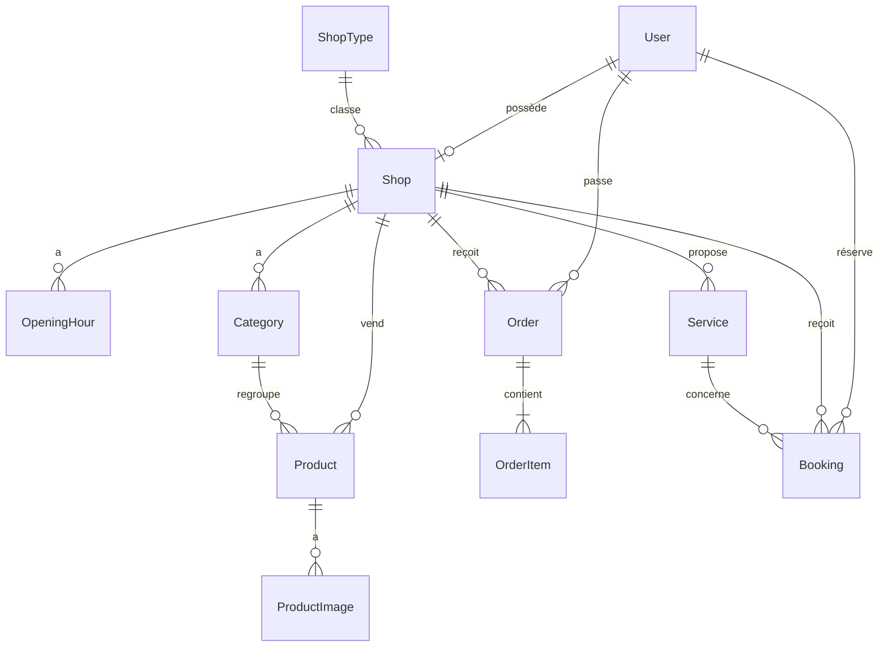
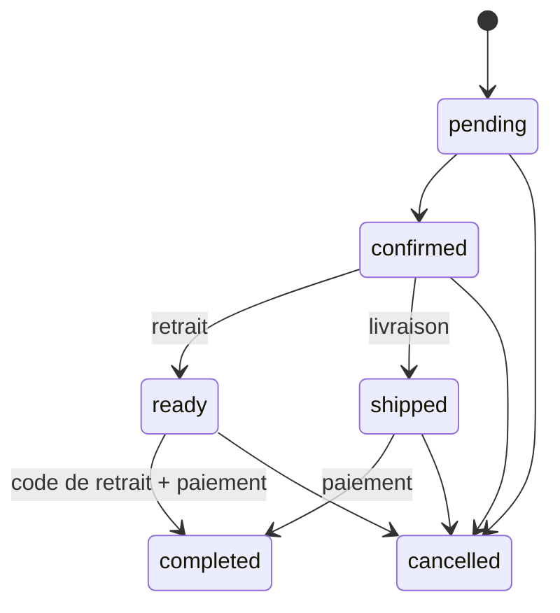

# Architecture

Monolithe Django 5 rendu côté serveur, enrichi par HTMX. Pas d'API ni de framework JavaScript : pages légères, adaptées aux connexions mobiles.

## Applications

| Application | Responsabilité |
| --- | --- |
| `core` | Accueil, recherche, pages d'information, utilitaires (téléphone, FCFA, champs), commande `seed_demo` |
| `accounts` | Utilisateur personnalisé (connexion par téléphone ou e-mail), inscription, profil, mot de passe |
| `shops` | Types de boutique, boutiques, horaires, validation par l'administration |
| `catalog` | Rayons, produits, photos, prestations |
| `cart` | Panier en session, regroupé par boutique, lien WhatsApp pré-rempli |
| `orders` | Commandes par boutique, code de retrait, statuts, stock |
| `bookings` | Rendez-vous (coiffure, services) et réservations de tables (restaurants, bars) |
| `dashboard` | Espace commerçant : statistiques, catalogue, commandes, réservations, réglages |

## Modèle de données

Points clés :

- **User** : `USERNAME_FIELD = "phone"`, e-mail facultatif et unique. Rôles : client, commerçant, administrateur.
- **ShopType** : définit les fonctionnalités d'une famille de boutique (produits, rendez-vous, tables). 16 types sont créés par la migration `shops.0002`.
- **Shop** : un commerçant possède une boutique (`OneToOneField`). Statut `pending` à la création, `approved` après validation, `suspended` en cas de problème. Seules les boutiques `approved` sont publiques (`Shop.objects.public()`).
- **Product** : prix en FCFA, ancien prix facultatif (promotion), stock facultatif (`None` = non suivi).
- **Order** : une commande concerne **une seule boutique**. Les lignes copient le nom et le prix du produit au moment de la commande.
- **Booking** : `kind` = `appointment` (avec prestation) ou `table` (avec nombre de personnes).

## Paiement sur place

Il n'y a **aucun paiement en ligne**. Le client choisit à la commande le moyen prévu (espèces, MTN MoMo, Orange Money) parmi ceux acceptés par la boutique. Les numéros Mobile Money de la boutique sont affichés pour un transfert fait devant le commerçant ou le livreur. Le commerçant enregistre le moyen réellement utilisé lors de la clôture (`paid_with`, `paid_at`).

## Cycle de vie d'une commande

Règles (`apps/orders/services.py`) :

- `place_order` verrouille les produits (`select_for_update`), vérifie le stock, crée la commande et décrémente le stock dans une transaction.
- `change_status` refuse toute transition non prévue par `Order.next_statuses()`.
- Clôturer une commande en retrait exige le **code à 6 chiffres** donné au client.
- Une annulation remet les quantités en stock.
- Le client peut annuler tant que la commande est `pending` ou `confirmed`.

## Réservations

- Créneau au moins 30 minutes à l'avance et au plus 60 jours.
- Refusé si la boutique est fermée à ce moment selon ses horaires.
- Le commerçant confirme ou refuse, puis marque « honorée » ou « absent ».

## Fuseau horaire et langue

- `TIME_ZONE = "Africa/Douala"` (UTC+1, sans heure d'été).
- `LANGUAGE_CODE = "fr"`, anglais disponible via le sélecteur FR/EN (`/i18n/setlang/`).
