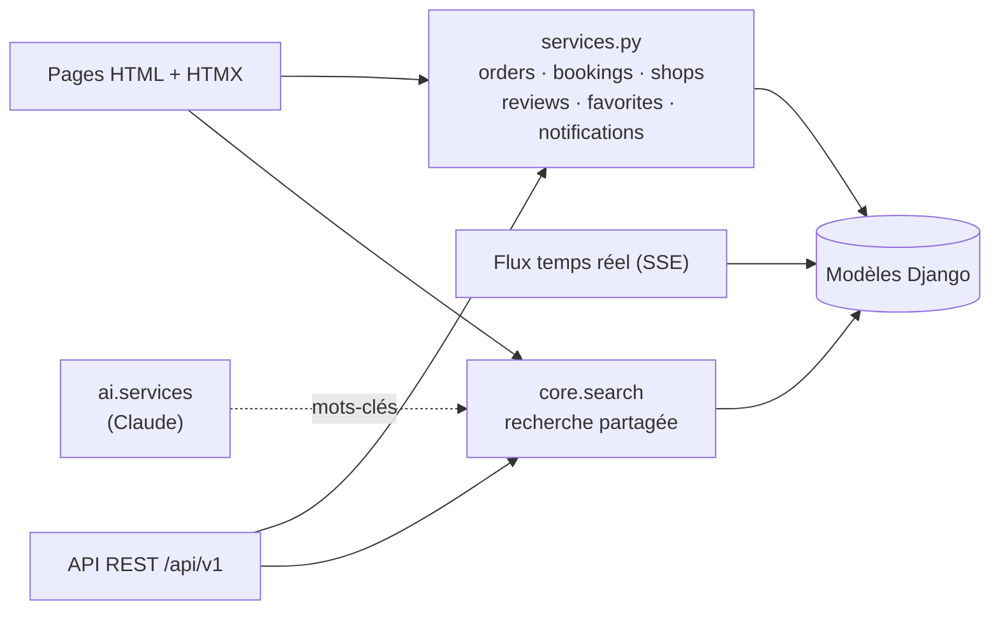
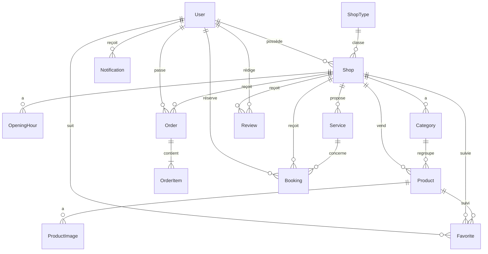
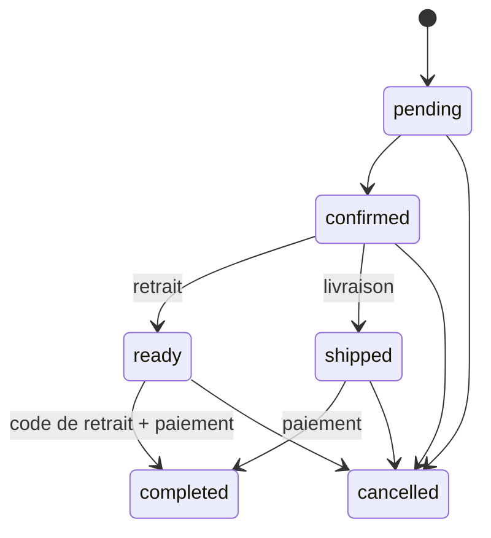
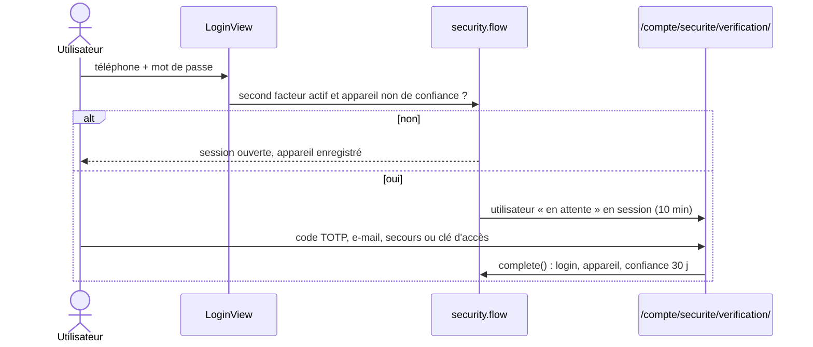

Monolithe Django 5 servi en **ASGI** (Uvicorn), rendu côté serveur et enrichi par HTMX : pages légères, adaptées aux connexions mobiles, installables comme une application (PWA). Une **API REST** documentée expose les mêmes fonctions aux applications tierces.

## Principe : une seule source de vérité

Les règles métier vivent dans des modules `services.py`. Les pages, l'API et le temps réel les appellent ; aucun ne réimplémente une règle.

| Règle | Module |
| --- | --- |
| Créer une commande, transitions de statut, stock, code de retrait | `apps/orders/services.py` |
| Créer, annuler, confirmer une réservation | `apps/bookings/services.py` |
| Créer une boutique, valider ou suspendre | `apps/shops/services.py` |
| Recherche catalogue (pages, palette, API) et recherche élargie | `apps/core/search.py` |
| Droit de noter (client servi), note moyenne, réponse du commerçant | `apps/reviews/services.py` |
| Favoris, alerte de retour en stock | `apps/favorites/services.py`, `apps/favorites/signals.py` |
| Notifications (base + e-mail) | `apps/notifications/services.py` |
| Statistiques de ventes et export CSV | `apps/dashboard/stats.py` |
| Optimisation des images, suppression des fichiers remplacés | `apps/core/images.py` |
| Validation des saisies (commande, réservation) | Formulaires Django, réutilisés tels quels par l'API |

## Applications

| Application | Responsabilité |
| --- | --- |
| `core` | Accueil, recherche, pages d'information, utilitaires (téléphone, FCFA, champs), commande `seed_demo` |
| `accounts` | Utilisateur personnalisé (connexion par téléphone ou e-mail), inscription, profil, mot de passe |
| `shops` | Types de boutique, boutiques, horaires, validation par l'administration |
| `catalog` | Rayons, produits, photos, prestations |
| `cart` | Panier en session, regroupé par boutique, lien WhatsApp pré-rempli |
| `orders` | Commandes par boutique, code de retrait, statuts, stock |
| `bookings` | Rendez-vous (coiffure, services) et réservations de tables (restaurants, bars) |
| `dashboard` | Espace commerçant : tableau de bord, statistiques et export CSV, catalogue, commandes, réservations, avis, réglages, affiche QR code, flux temps réel |
| `reviews` | Avis clients vérifiés (1 par client et par boutique), réponse publique, modération |
| `favorites` | Boutiques et produits suivis, alerte de retour en stock |
| `notifications` | Centre de notifications (cloche), envoi par e-mail si l'utilisateur en a un |
| `security` | Limitation des essais, appareils et alertes de connexion, double authentification (TOTP, e-mail, clés d'accès WebAuthn, codes de secours) |
| `api` | API REST v1 (Django Ninja) : catalogue, compte client, espace commerçant, jetons d'accès |
| `ai` | Assistant IA (API Claude) : descriptions produits, mots-clés de recherche |

## Modèle de données

Points clés :

- **User** : `USERNAME_FIELD = "phone"`, e-mail facultatif et unique. Rôles : client, commerçant, administrateur.
- **ShopType** : définit les fonctionnalités d'une famille de boutique (produits, rendez-vous, tables). 16 types sont créés par la migration `shops.0002`.
- **Shop** : un commerçant peut posséder plusieurs boutiques (`ForeignKey`, `user.shops`). Dans l'espace commerçant, la boutique courante est mémorisée en session (`dashboard_shop_id`) et exposée par le décorateur `merchant_required` (`request.shop`, `request.shops`). Statut `pending` à la création, `approved` après validation, `suspended` en cas de problème. Seules les boutiques `approved` sont publiques (`Shop.objects.public()`).
- **Product** : prix en FCFA, ancien prix facultatif (promotion), stock facultatif (`None` = non suivi).
- **Order** : une commande concerne **une seule boutique**. Les lignes copient le nom et le prix du produit au moment de la commande.
- **Booking** : `kind` = `appointment` (avec prestation) ou `table` (avec nombre de personnes).
- **Review** : contrainte d'unicité `(shop, customer)` et note de 1 à 5 en base. `Shop.objects.with_rating()` annote `rating_avg` et `rating_count` (avis publiés uniquement).
- **Favorite** : soit une boutique, soit un produit (contrainte `CheckConstraint`), unique par utilisateur.
- **Notification** : titre, message, lien, date de lecture ; `kind` = `restock`, `review` ou `reply`.

## Paiement sur place

Il n'y a **aucun paiement en ligne**. Le client choisit à la commande le moyen prévu (espèces, MTN MoMo, Orange Money) parmi ceux acceptés par la boutique. Les numéros Mobile Money de la boutique sont affichés pour un transfert fait devant le commerçant ou le livreur. Le commerçant enregistre le moyen réellement utilisé lors de la clôture (`paid_with`, `paid_at`).

## Cycle de vie d'une commande

Règles (`apps/orders/services.py`) :

- `place_order` verrouille les produits (`select_for_update`), vérifie le stock, crée la commande et décrémente le stock dans une transaction.
- `change_status` refuse toute transition non prévue par `Order.next_statuses()`.
- Clôturer une commande en retrait exige le **code à 6 chiffres** donné au client.
- Une annulation remet les quantités en stock.
- Le client peut annuler tant que la commande est `pending` ou `confirmed`.

## Réservations

- Créneau au moins 30 minutes à l'avance et au plus 60 jours.
- Refusé si la boutique est fermée à ce moment selon ses horaires.
- Le commerçant confirme ou refuse, puis marque « honorée » ou « absent ».

## Avis, favoris et notifications

- `reviews.services.can_review()` n'autorise que les clients ayant une commande `completed` ou une réservation `completed` dans la boutique, jamais son propriétaire. `save_review()` crée ou met à jour l'avis et prévient le commerçant à la création ; `reply()` prévient le client à la première réponse.
- Un signal `pre_save`/`post_save` sur `Product` (`apps/favorites/signals.py`) détecte le passage d'un stock de 0 à disponible et, après validation de la transaction (`on_commit`), notifie les clients qui suivent le produit.
- `notifications.services.notify()` enregistre la notification et l'envoie par e-mail après la transaction si l'utilisateur a une adresse. Le compteur de la cloche vient du processeur de contexte `notifications`.

## Sécurité des comptes

| Module (`apps/security/`) | Rôle |
| --- | --- |
| `throttle.py` | Compteurs en cache par identifiant et par IP : mot de passe, codes, jetons d'API, clés d'accès |
| `devices.py` | Cookie `mm_device` (aléatoire, seule son empreinte SHA-256 est stockée), alerte de nouvel appareil, confiance 30 jours, fin de session à distance |
| `factors.py` | TOTP (RFC 6238, `pyotp`, anti-rejeu par pas de temps), code e-mail (cache, 10 min), codes de secours (empreintes SHA-256, usage unique), niveau de sécurité |
| `passkeys.py` | WebAuthn (`webauthn`) : options et vérification, défi en session, clés découvrables pour la connexion sans mot de passe |
| `flow.py` | Connexion en deux étapes, `recent_auth_required` (mot de passe redemandé après 10 minutes pour modifier la sécurité) |
| `middleware.py` | `StaffMFAMiddleware` : `/admin/` exige un facteur fort ; `/admin/login/` redirige vers la connexion du site |
| `crypto.py` | Chiffrement Fernet des secrets TOTP (`MFA_ENCRYPTION_KEY`) |

Les essais de codes sont limités **par compte** (et non par tentative de connexion) : se reconnecter ne donne pas de nouveaux essais. L'obtention d'un jeton d'API exige le code TOTP ou un code de secours si la double authentification est active.

## Images

`apps/core/images.py` centralise le traitement des photos :

| Élément | Rôle |
| --- | --- |
| `optimize_image()` | Corrige l'orientation EXIF, vérifie poids (5 Mo) et dimensions minimales, recadre au centre si demandé, convertit en WebP |
| `OptimizedImagesMixin` | Applique `optimize_image()` aux champs listés dans `image_specs` d'un formulaire |
| `@cleanup_files` | Décorateur de modèle : supprime du stockage les fichiers remplacés, vidés ou dont l'objet est supprimé (après la transaction) |
| `ImagePicker` | Widget avec aperçu, glisser-déposer et case « Supprimer l'image » (`apps/core/widgets.py`) |

| Image | Taille produite | Minimum |
| --- | --- | --- |
| Logo de boutique | 512 × 512 (recadrée) | 128 × 128 |
| Bannière de boutique | 1800 × 600 (recadrée) | 900 × 300 |
| Photo produit | 1600 px de côté maximum | 300 × 300 |

## Icônes

Les icônes viennent de [Lucide](https://lucide.dev/) (licence ISC), plus le logo WhatsApp. Elles sont rendues en SVG dans le HTML par la balise `` (bibliothèque `mall`, chargée partout), sans police ni JavaScript. Un nom inconnu affiche l'icône `store`. Le paramètre `label` rend l'icône lisible par les lecteurs d'écran ; sinon elle est décorative (`aria-hidden`).

`npm run icons` (script `scripts/icons.mjs`) relève les icônes utilisées dans les gabarits et celles listées dans `static/src/icons.json` (icônes des types de boutique et des notifications), puis les extrait du paquet `lucide-static` vers `apps/core/icons.json`. La CI vérifie que ce fichier est à jour.

## Fuseau horaire et langue

- `TIME_ZONE = "Africa/Douala"` (UTC+1, sans heure d'été).
- `LANGUAGE_CODE = "fr"`, anglais disponible via le sélecteur FR/EN (`/i18n/setlang/`).

## Temps réel commerçant

`apps/dashboard/realtime.py` expose `/espace-boutique/flux/`, un flux **Server-Sent Events**. Le serveur interroge la base toutes les `REALTIME_POLL_SECONDS` secondes et envoie chaque nouvelle commande ou réservation de la boutique courante. Aucune infrastructure supplémentaire (ni Redis, ni WebSocket) n'est nécessaire.

- Chaque événement porte un identifiant `commande:réservation` (`id: 42:7`). À la reconnexion, le navigateur renvoie `Last-Event-ID` et ne perd aucun événement.
- Le flux se ferme au bout de `REALTIME_STREAM_SECONDS` ; `EventSource` se reconnecte seul.
- Sous ASGI (production), le flux ne bloque aucun worker. Sous `runserver`, il occupe un thread.
- Côté navigateur (`static/js/live.js`) : badge, toast, son, notification système, et rafraîchissement HTMX des listes (`live:order`, `live:booking`).

## Application installable (PWA)

| Élément | Rôle |
| --- | --- |
| `/manifest.webmanifest` | Nom, icônes (dont masquable), couleurs, raccourcis |
| `/sw.js` | Service worker : statiques en cache, pages publiques en réseau d'abord avec repli, page `/hors-ligne/` |
| `PrivateCacheMiddleware` | Ajoute `Cache-Control: private` aux réponses des utilisateurs connectés : ni les proxys ni le service worker ne les gardent |

Les préfixes privés (`/compte/`, `/panier/`, `/commandes/`, `/espace-boutique/`, `/api/`...) ne sont jamais mis en cache.

## Assistant IA

`apps/ai/services.py` appelle l'API Claude avec des **sorties structurées** (schéma JSON validé par Pydantic) et le **repli serveur** `fallbacks: "default"` en cas de refus. Sans `ANTHROPIC_API_KEY`, l'assistant est désactivé et l'interface masque ses boutons ; toute erreur (réseau, quota, refus, réponse invalide) devient `AIUnavailable` et l'application continue sans lui.

| Fonction | Usage |
| --- | --- |
| `describe_product()` | Bouton « Rédiger avec l'IA » de la fiche produit (texte, rayon, prix, notes et photo) ; quota par commerçant |
| `expand_search()` | Quand une recherche trouve moins de 3 produits, propose des mots-clés (synonymes, termes locaux) ; résultat mis en cache 24 h |

## Observabilité

- `/healthz` : état de la base et du cache (200 ou 503), version de l'application. `python manage.py healthcheck` fait la même vérification (healthcheck Docker).
- Chaque requête reçoit un identifiant (`X-Request-ID`, repris s'il est fourni) présent dans tous les logs.
- Logs **JSON** en production (`LOG_FORMAT=json`), texte en développement.
- Typage statique strict (mypy + django-stubs) vérifié en CI ; des tests bornent le nombre de requêtes SQL des pages principales.
