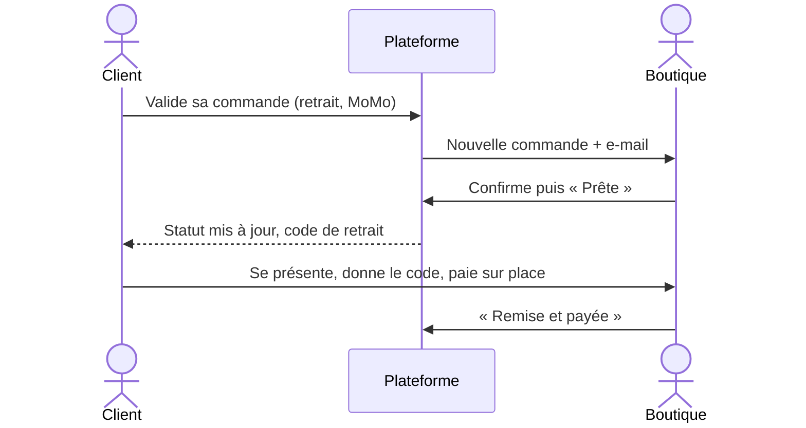

Mfoundi Mall en ligne réunit les boutiques du **Mfoundi Mall** (Yaoundé, Cameroun) sur un seul site : épiceries, téléphonie, coiffure, restaurants, bars, caves, parfumeries, électroménager et bien d'autres. Chaque boutique crée son espace, publie produits et services, puis reçoit commandes et réservations.

## Les principes

- **Prix en Franc CFA (FCFA).**
- **Aucun paiement en ligne.** On paie sur place, devant le commerçant ou le livreur : espèces, MTN Mobile Money ou Orange Money.
- **Une commande par boutique.** Le panier peut mélanger plusieurs boutiques ; chacune reçoit et traite sa propre commande.
- **Retrait en boutique** avec un code à 6 chiffres, ou **livraison** si la boutique la propose.
- **Réservations** de rendez-vous (salons, services) et de tables (restaurants, bars).
- **WhatsApp** : chaque boutique est joignable en un clic.
- **Connexion par numéro de téléphone** (+237) ou e-mail.
- Site disponible en **français** et en **anglais**, en **thème clair ou sombre**.
- **Application installable** sur téléphone, consultable hors ligne.
- **Commerçants prévenus en direct** des nouvelles commandes et réservations.
- **Avis clients vérifiés** : seuls les clients servis notent la boutique, qui peut répondre.
- **Favoris et alertes** de retour en stock, centre de notifications.
- **Statistiques de ventes** et export comptable CSV pour chaque boutique.
- **Plan du mall** par étage et **affiche QR code** à imprimer pour chaque vitrine.
- **Assistant IA** : descriptions produits et recherche élargie.
- **API REST** documentée pour les applications partenaires.

## Qui fait quoi ?

| Rôle | Peut |
| --- | --- |
| Client | Chercher, commander, réserver, suivre ses commandes, contacter une boutique, suivre ses favoris, noter une boutique |
| Commerçant | Gérer une ou plusieurs boutiques : logo et bannière, catalogue, horaires, paiement, commandes, réservations, avis, statistiques |
| Administration du mall | Valider ou suspendre les boutiques, mettre en avant, gérer les types de boutique et les utilisateurs, modérer les avis |

## Le parcours d'une commande

## Aperçu

| Boutique | Espace commerçant |
| --- | --- |
|  |  |
|  |  |
